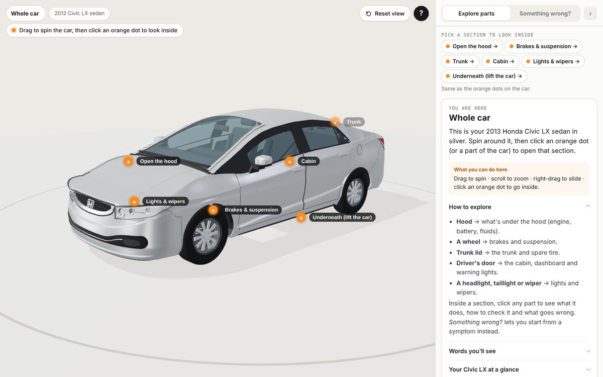
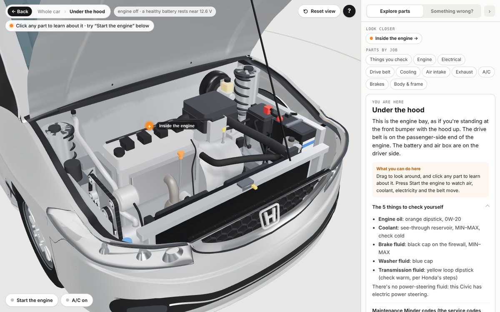
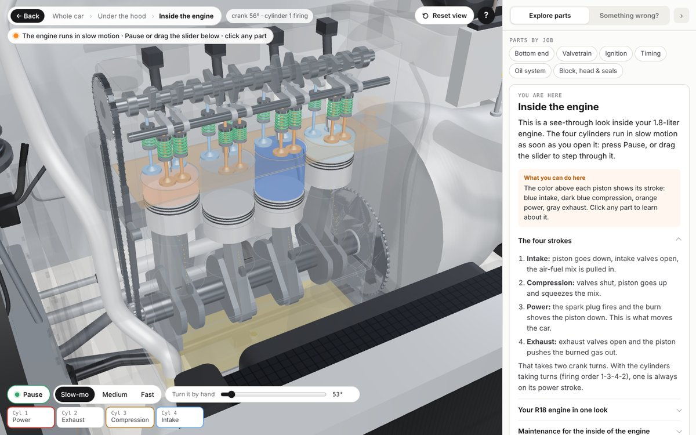
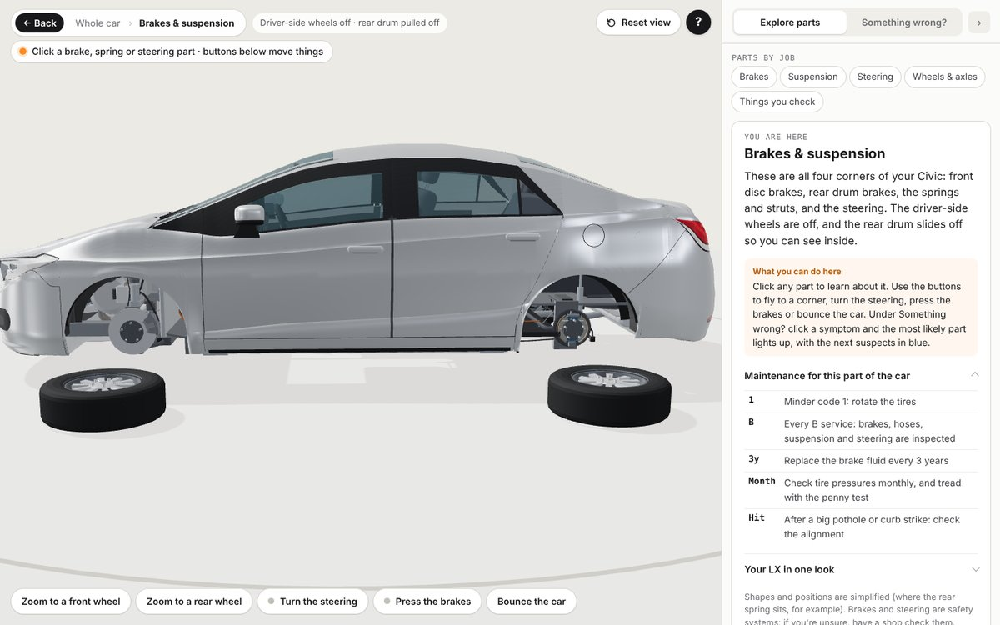
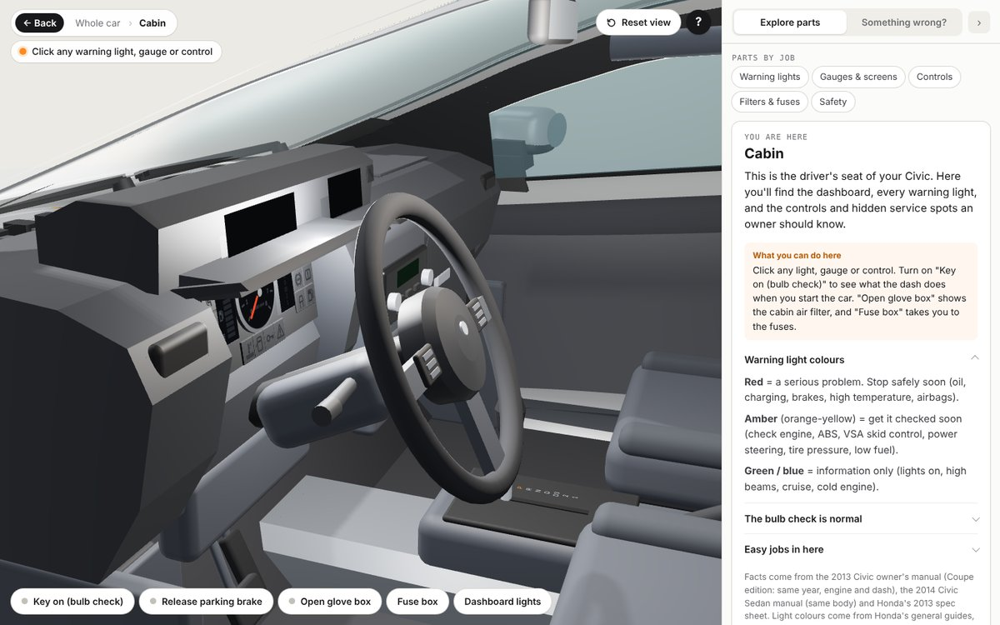

# Honda Civic 3D Model

[](https://github.com/WilwilMina/Honda-Civic3D-Model/actions/workflows/pages.yml)
[](LICENSE)

An interactive 3D model of a 2013 Honda Civic LX for car beginners. Open the hood, watch the engine run, and
learn what every part does, how to check it, and what a symptom might mean.

**[▶ Open the live demo](https://wilwilmina.github.io/Honda-Civic3D-Model/)**: runs in your browser, nothing to
install (laptop or desktop).



## What you can do

- **Explore 8 areas:** under the hood, inside the engine, brakes and suspension, trunk, cabin, lights and
  wipers, and the underside on a lift.
- **Click any part** to see what it does, how to check it, signs it's failing, and repair videos. The rest of
  the car fades to see-through grey so the part stands out.
- **"Something wrong?"** Pick a symptom (a noise, a smell, a warning light) to see how urgent it is and the
  likely causes, highlighted on the model.
- **Watch it work:** start the engine, press the brakes, turn the steering, lift the car.

|                                                   |                                              |
| ------------------------------------------------- | -------------------------------------------- |
|             |  |
|  |               |

## How to use it

1. **Drag** to spin the car, **scroll** to zoom.
2. **Click an orange dot** (or the hood, a wheel, the trunk) to go inside that area.
3. **Click a part** to read about it. **Back** or `Esc` goes up a level.

## Run it yourself

Needs [Node.js](https://nodejs.org) 22.12+.

```sh
npm install
npm run dev     # live-reloading dev server
npm run build   # dist/index.html: one file that works offline
```

## Learn more

- **[Developer guide](docs/DEVELOPING.md):** project structure, where to change things, how it's built,
  exporting to Blender and `.glb`, and deploying.
- **[Architecture](docs/ARCHITECTURE.md):** the area API, the content format, and how to add a part.
- **[Sources and credits](docs/SOURCES.md):** where every fact comes from, plus reference photo credits.

Built with plain JavaScript, [three.js](https://threejs.org) and [Vite](https://vite.dev). Every part is
modelled in code; there are no downloaded 3D models.

## Good to know

- It's recognisably a 2013 Civic sedan, not a photo-real replica.
- It's made for laptops and desktops; phones get a "best on a bigger screen" notice.
- It's for learning, **not a substitute for the owner's manual or a mechanic**, especially for brakes and
  anything safety-related.

## License

[MIT](LICENSE), © 2026 Mina Abdel-Masih. "Honda" and "Civic" are trademarks of Honda Motor Co., Ltd. This is an
unofficial learning project, not affiliated with Honda. Video links and third-party sites belong to their
owners. Built with help from Claude (Anthropic).
